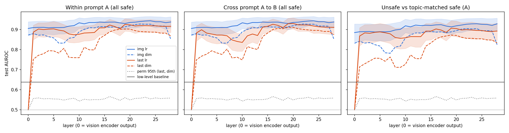

# See_the_Harm
An interpretability study on the process of encoding and use of harm in VLMs as a linear direction.

## RQ1: is image harm linearly decodable?

Can harmfulness in natural images be linearly decoded from the hidden states of
**Qwen2.5-VL-7B-Instruct** when the text carries no harm, and is the readout one stable direction?

Every image (VLSU, unsafe vs safe) gets the same harmless prompt, so any difference in the
activations has to come from the image. The full design, controls and pass/fail criteria are in
[docs/analysis_plan.md](docs/analysis_plan.md), which is committed before any data is collected.

| Control | What it rules out |
|---|---|
| Two prompt wordings, cross-tested | A direction tied to one prompt's wording |
| Layer 0 image tokens (vision encoder output) | Harm that is already linear in the vision encoder, with the LLM adding nothing |
| Low-level image statistics | Size, colour or edge statistics separating the classes |
| Fixed 448x448 input | Image-token count as a confound (always 256) |
| Topic-matched safe images | A "weapons / drugs / violence topic" detector instead of a harm detector |
| Leave-one-category-out | A probe that only works on harm categories it has seen |
| Permutation null | Chance-level separability in 3584 dimensions |

### Result

**Image harm is linearly decodable (test AUROC about 0.91–0.94), but it is already decodable at
the vision encoder output (0.906), so the LLM does not create it.** It is not explained by
low-level image statistics (0.638), the prompt wording, or image topic (unsafe vs topic-matched
safe 0.892), and it transfers to unseen harm categories (mean 0.900). Pre-registered criteria
passed: 3 of 5. "Beyond the vision encoder" failed, and "single direction" failed at the
pre-specified layer 14. Exploratory: a stable single direction appears at the last token from
about layer 19.

Full write-up: [docs/rq1_conclusion.md](docs/rq1_conclusion.md). Numbers and plots:
[results/final/](results/final/).



## Layout

```
docs/analysis_plan.md          design, analyses, decision criteria
scripts/build_dataset.py       VLSU -> data/images + data/manifest.jsonl (network, no model)
scripts/extract_activations.py hidden states, mean image tokens + last token, 29 layers (GPU)
scripts/lowlevel_features.py   image statistics for the low-level baseline (CPU)
scripts/probes.py              all probe analyses for --stage pilot | final (CPU)
scripts/report.py              plots + summary.md with the criteria table
setup/                         login-node setup: venv, model weights, dataset download
slurm/                         batch jobs
```

## Running on the cluster

Cluster limits: 1 GPU per job, at most 40 CPUs with 4 GB RAM each, 24 h per job. The login node
is for light work only. The two setup scripts only download (pip packages, ~16 GB of weights,
~750 images with 4 threads), because compute nodes may have no internet. Everything else runs
under Slurm.

```bash
# login node, once
git clone https://github.com/Aurnawr/See_the_Harm && cd See_the_Harm
bash setup/setup_venv.sh
bash setup/download_assets.sh
cat data/dataset_report.json          # check kept counts and any category shortfall

# optional smoke test of extraction on 20 images
mkdir -p logs && sbatch --export=ALL,LIMIT=20 slurm/extract.sbatch

# extraction (GPU) followed by the pilot analysis (CPU)
bash slurm/submit_pilot.sh
squeue -u $USER
```

The pilot writes `results/pilot/summary.md`, `decodability.png` and `directions.png`. It uses
only the pilot split (20%), with 5-fold CV inside it.

Run the final stage **only** after reviewing the pilot and committing any change to the
analysis plan or scripts. `run_info.json` records the commit and whether `scripts/` or `docs/`
had uncommitted changes.

```bash
sbatch --export=ALL,STAGE=final slurm/probes.sbatch
```
