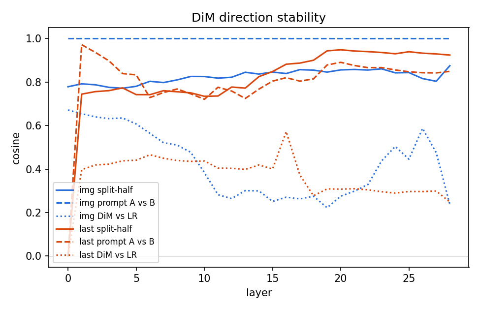

# RQ1 results (final)

L* = layer 14 (highest LR AUROC, last token, prompt A, chosen on the pilot stage).

| Criterion | Numbers | Pass |
|---|---|---|
| Decodable beyond vision encoder | LR AUROC 0.908 [0.872, 0.940]; perm p95 0.557 (LR); vision-encoder 0.906 | no |
| Not a low-level artefact | low-level AUROC 0.638 | yes |
| Text-independent | cross-prompt 0.912 vs within 0.908 | yes |
| Harm, not topic | unsafe vs matched 0.892; mean LOCO 0.900 over 8 categories | yes |
| Single direction | DiM 0.856 vs LR 0.908; split-half cos 0.825; A vs B cos 0.767 | no |

## Leave-one-category-out at L* (last token, LR)

| subset   |   auroc |   auroc_lo |   auroc_hi |   n_pos |   n_neg |
|:---------|--------:|-----------:|-----------:|--------:|--------:|
| C1       |   0.951 |      0.854 |      1.000 |  12.000 |  12.000 |
| C10      |   0.861 |      0.728 |      0.966 |  18.000 |  18.000 |
| C11      |   0.875 |      0.688 |      1.000 |  12.000 |  12.000 |
| C3       |   0.944 |      0.832 |      1.000 |  14.000 |  14.000 |
| C4       |   0.910 |      0.720 |      1.000 |  10.000 |  10.000 |
| C5       |   0.926 |      0.785 |      1.000 |  11.000 |  11.000 |
| C8       |   0.926 |      0.789 |      1.000 |  16.000 |  16.000 |
| C9       |   0.806 |      0.632 |      0.956 |  19.000 |  19.000 |

