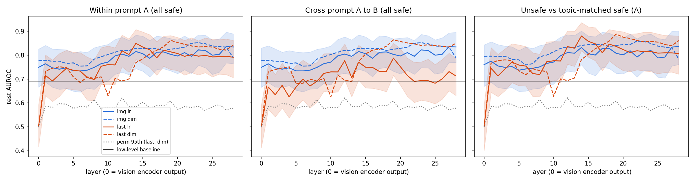
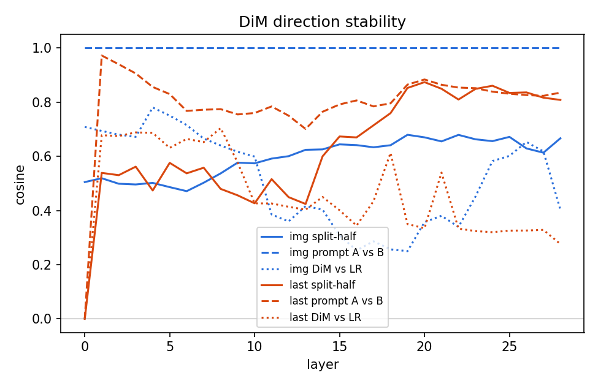

# RQ1 results (pilot)

Pilot numbers come from 5-fold CV on the pilot split only. They are for debugging, not for conclusions.

L* = layer 14 (highest LR AUROC, last token, prompt A).

| Criterion | Numbers | Pass |
|---|---|---|
| Decodable beyond vision encoder | LR AUROC 0.849 [0.782, 0.907]; perm p95 0.612 (LR); vision-encoder 0.749 | yes |
| Not a low-level artefact | low-level AUROC 0.691 | yes |
| Text-independent | cross-prompt 0.770 vs within 0.849 | no |
| Harm, not topic | unsafe vs matched 0.880; mean LOCO 0.881 over 3 categories | yes |
| Single direction | DiM 0.769 vs LR 0.849; split-half cos 0.600; A vs B cos 0.764 | no |

## Leave-one-category-out at L* (last token, LR)

| subset   |   auroc |   auroc_lo |   auroc_hi |   n_pos |   n_neg |
|:---------|--------:|-----------:|-----------:|--------:|--------:|
| C8       |   0.875 |      0.672 |      1.000 |   8.000 |   8.000 |
| C10      |   0.891 |      0.625 |      1.000 |   8.000 |   8.000 |
| C9       |   0.877 |      0.691 |      1.000 |   9.000 |   9.000 |

